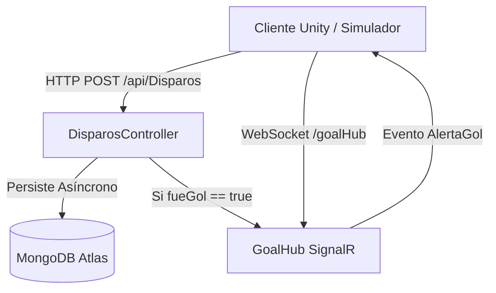

# GoalLine Backend 🚀

Este repositorio contiene el backend de **GoalLine**, desarrollado con **.NET 8 (C#)**, la infraestructura de despliegue automatizada en la nube de **AWS**, y las especificaciones técnicas para establecer la conexión en tiempo real con clientes en **Unity**.

---

## 📌 1. Arquitectura y Funcionamiento del Backend

El backend está diseñado para recibir, registrar en base de datos de manera no bloqueante y retransmitir en tiempo real eventos de disparos a portería (especialmente alertas de goles) originados desde el simulador o cliente en Unity.



### Componentes Clave del Código
*   **`DisparosController.cs`:** 
    Expone el endpoint `POST /api/Disparos`. Recibe la información del disparo, le inyecta la marca de tiempo exacta en formato UTC (`DateTime.UtcNow`) y la guarda asíncronamente en MongoDB Atlas. Si el disparo resulta en gol (`FueGol == true`), invoca al `IHubContext<GoalHub>` para notificar inmediatamente a todos los suscriptores conectados.
*   **`GoalHub.cs`:**
    Define el hub de comunicación bidireccional bajo la ruta `/goalHub` para notificaciones instantáneas de baja latencia usando WebSockets.
*   **`Dockerfile` (Optimizado para Alpine):**
    Construye la imagen final basándose en **Alpine Linux** (`aspnet:8.0-alpine`) reduciendo el tamaño a menos de 100 MB. Incorpora variables de entorno críticas para servidores de baja capacidad (1GB RAM t2.micro):
    *   `DOTNET_gcServer=0`: Forza al Garbage Collector al modo Workstation (consume mucha menos RAM basal).
    *   `DOTNET_TieredPGO=0`: Desactiva la optimización guiada por perfiles pesada en CPU durante el inicio.

---

## 🔑 2. Gestión de Usuarios, Seguridad e Intercambio de Keys

El despliegue en la nube de AWS se rige bajo el principio de **mínimo privilegio** y accesos criptográficos fuertes.

### A. Usuario de Despliegue (IAM) y Terraform
Para automatizar el aprovisionamiento de infraestructura mediante Terraform sin comprometer la cuenta raíz de AWS:
1. Se creó un usuario específico en AWS IAM llamado **`terraform-deploy`**.
2. Este usuario se asoció al grupo **`TerraGroup`**, el cual cuenta con políticas de permisos específicas para crear redes (VPC), instancias EC2 y reglas de seguridad.
3. Se generaron **Access Keys (Credenciales Criptográficas)** para este usuario:
   *   `AWS_ACCESS_KEY_ID`: Identificador público de acceso.
   *   `AWS_SECRET_ACCESS_KEY`: Clave privada de firma.
4. **Configuración Local:** Estas llaves se configuran en las variables de entorno de tu máquina de desarrollo local (`~/.aws/credentials` o variables de entorno locales de Windows) permitiendo a Terraform interactúe de forma segura y transparente contra la API de AWS.

### B. Acceso SSH al Servidor EC2
Para administrar la instancia Linux EC2 donde corre Docker:
1. Se generó un par de llaves criptográficas en AWS. La llave pública queda instalada de forma segura en la instancia EC2.
2. La llave privada correspondiente se descargó en tu computadora con el nombre **`goalline-ssh-key.pem`**.
3. **Acceso Seguro por Consola:** La clave privada actúa como tu firma digital para entrar sin contraseñas:
   ```bash
   ssh -i C:\Users\aacar\Documents\goalline-ssh-key.pem ubuntu@13.221.153.138
   ```

> [!WARNING]
> La llave privada `.pem` es de máxima seguridad. Nunca la agregues a tu repositorio Git. Asegúrate de que esté excluida en tu `.gitignore`.

---

## 🎮 3. Conexión del Backend con Unity

Para que tu videojuego o simulador en Unity interactúe con el backend, debe implementar tanto peticiones HTTP como una conexión por WebSockets utilizando SignalR.

### Paso 1: Importar dependencias en Unity
1. Para peticiones REST tradicionales, Unity cuenta con `UnityEngine.Networking` nativo.
2. Para SignalR, se recomienda instalar el paquete oficial de Microsoft para Unity a través de NuGet, o bien utilizar la librería popular compatible con Unity [BestHTTP/SignalR](https://assetstore.unity.com/) o el SDK oficial de SignalR compilado para .NET Standard.

### Paso 2: Script de envío de Disparos (HTTP POST)
Este script en C# de Unity empaqueta las coordenadas, velocidad y estado del tiro, enviándolo a la base de datos de AWS:

```csharp
using System;
using System.Text;
using System.Collections;
using UnityEngine;
using UnityEngine.Networking;

[Serializable]
public class Disparo
{
    public float coordenadaX;
    public float coordenadaY;
    public float velocidad;
    public bool fueGol;
    public string timestampUnity;
}

public class GoalLineClient : MonoBehaviour
{
    // Reemplaza por el puerto correspondiente (ejemplo, 80 o 8080)
    private string apiURL = "http://13.221.153.138:8080/api/Disparos";

    public void EnviarRegistroDisparo(float x, float y, float vel, bool gol)
    {
        Disparo nuevoDisparo = new Disparo
        {
            coordenadaX = x,
            coordenadaY = y,
            velocidad = vel,
            fueGol = gol,
            timestampUnity = DateTime.UtcNow.ToString("o") // Formato ISO 8601
        };

        StartCoroutine(PostDisparoCoroutine(nuevoDisparo));
    }

    private IEnumerator PostDisparoCoroutine(Disparo disparo)
    {
        string jsonPayload = JsonUtility.ToJson(disparo);
        
        using (UnityWebRequest request = new UnityWebRequest(apiURL, "POST"))
        {
            byte[] bodyRaw = Encoding.UTF8.GetBytes(jsonPayload);
            request.uploadHandler = new UploadHandlerRaw(bodyRaw);
            request.downloadHandler = new DownloadHandlerBuffer();
            request.SetRequestHeader("Content-Type", "application/json");

            yield return request.SendWebRequest();

            if (request.result == UnityWebRequest.Result.Success)
            {
                Debug.Log("¡Disparo registrado exitosamente! Respuesta: " + request.downloadHandler.text);
            }
            else
            {
                Debug.LogError("Error enviando disparo: " + request.error);
            }
        }
    }
}
```

### Paso 3: Script de recepción de alertas en tiempo real (SignalR)
El siguiente script permite a Unity suscribirse a la transmisión directa del servidor y reaccionar de inmediato cuando se anota un gol:

```csharp
using UnityEngine;
using Microsoft.AspNetCore.SignalR.Client;
using System;

public class SignalRListener : MonoBehaviour
{
    private HubConnection hubConnection;
    private string hubURL = "http://13.221.153.138:8080/goalHub";

    async void Start()
    {
        // 1. Configurar e instanciar la conexión del Hub
        hubConnection = new HubConnectionBuilder()
            .WithUrl(hubURL)
            .WithAutomaticReconnect()
            .Build();

        // 2. Suscribirse al evento "AlertaGol" gatillado por el backend
        hubConnection.On<Disparo>("AlertaGol", (disparoRecibido) =>
        {
            // Ejecutar en el hilo principal de Unity
            Loom.QueueOnMainThread(() =>
            {
                GatillarEfectoGol(disparoRecibido);
            });
        });

        // 3. Iniciar la conexión
        try
        {
            await hubConnection.StartAsync();
            Debug.Log("¡Conectado exitosamente al Canal de SignalR en AWS!");
        }
        catch (Exception ex)
        {
            Debug.LogError("Error conectando a SignalR: " + ex.Message);
        }
    }

    private void GatillarEfectoGol(Disparo disparo)
    {
        Debug.LogWarning($"⚽ ¡¡¡GOOOL!!! Registrado a {disparo.velocidad} km/h!");
        // Aquí puedes encender luces, reproducir sonidos o activar animaciones en tu juego de Unity
    }

    async void OnDestroy()
    {
        if (hubConnection != null)
        {
            await hubConnection.DisposeAsync();
        }
    }
}
```

> [!NOTE]
> En Unity, las devoluciones de llamada de hilos en segundo plano (como las que usa SignalR) no pueden modificar objetos directamente en la escena. Se recomienda usar un patrón **Loom** o un despachador en el hilo principal (`MainThreadDispatcher`) para ejecutar de forma segura la lógica visual del juego.

---

## 🔒 4. Control de Entornos y Seguridad en Producción

El backend implementa un mecanismo inteligente de protección en producción para asegurar que solo los dispositivos de juego autorizados consuman las APIs, ocultando los paneles de testeo públicos:

```csharp
// Configuración en Program.cs
if (app.Environment.IsDevelopment())
{
    app.UseSwagger();
    app.UseSwaggerUI();
    app.UseDefaultFiles();
    app.UseStaticFiles();
}
```

### Comportamiento según el Entorno:
*   **Desarrollo (`Development`):**
    *   Swagger UI (`/swagger`) está activo para depuración.
    *   El simulador interactivo web (`index.html`) está activo para probar la integración rápidamente desde el navegador.
*   **Producción (`Production`):**
    *   ❌ Swagger UI devuelve un error **404 Not Found**.
    *   ❌ La página web de simulación devuelve un error **404 Not Found** (previniendo accesos no autorizados a la interfaz de usuario).
    *   ✔️ Las llamadas de Unity a `/api/Disparos` y las conexiones WebSocket a `/goalHub` continúan respondiendo con el máximo rendimiento.
